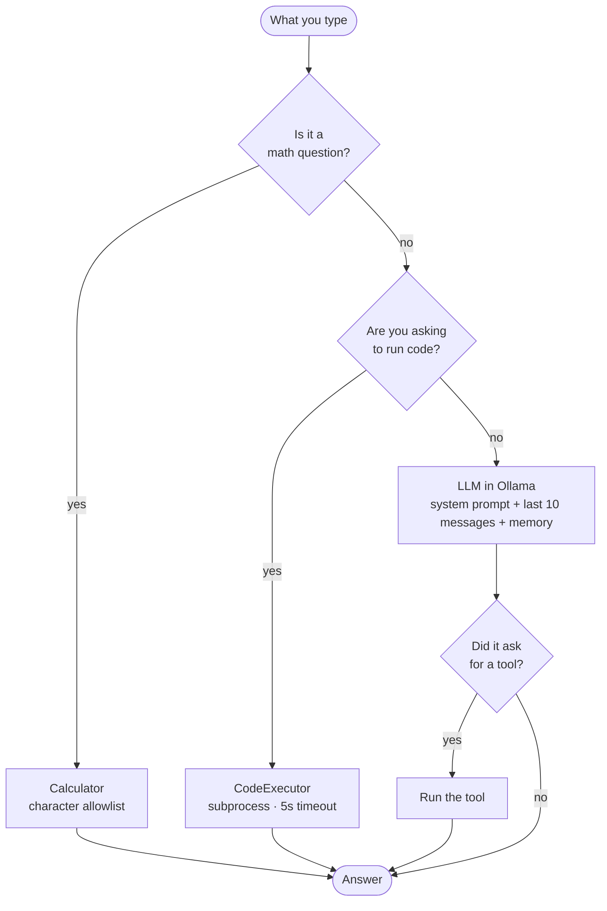
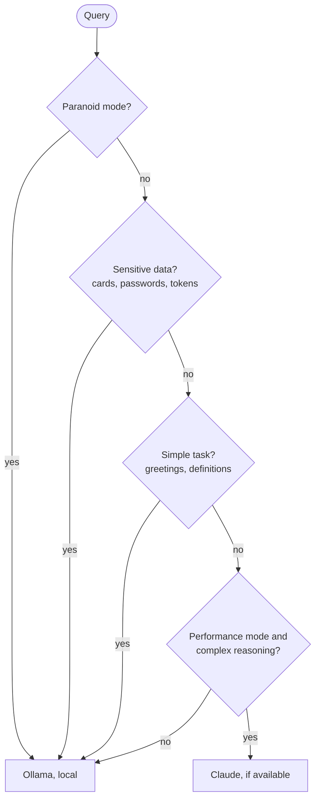

# CIBO

*[Versión en español](README.es.md)*

**An assistant that runs entirely on your machine, knows when to use a tool instead of making up the answer, and sends nothing to the cloud without permission.**

I started this on January 26, 2026 to really understand how an LLM works on the inside, instead of stopping at using ChatGPT. I wanted to run a local model, write the code around it myself and get properly comfortable with Python along the way: abstract classes, subprocesses, HTTP APIs, all the stuff you learn best when you need it for something of your own.

CIBO is an assistant that runs fully local with [Ollama](https://ollama.com/). It knows when it's better off reaching for a tool (a real calculator, a Python executor) instead of improvising the answer, and if I allow it, it can send queries to cloud models. By default nothing leaves the machine.

> **Project on indefinite hold.** I've shelved it and don't plan to pick it back up any time soon. The reasons are explained below, in [Project status](#project-status). I'm publishing it because the code is useful to see how this kind of thing is built, not as something finished or maintained.

> **Language note:** CIBO talks to you in Spanish. Its persona, its replies and the keywords it uses to detect intent (`calcula`, `ejecuta`, `analiza`…) are in Spanish. The code and the architecture are what this repo is about.

Some pieces are half-done. They're listed at the end, unvarnished.

## How it grew

**January 26, 2026.** The bare minimum to talk to the model: an HTTP client for Ollama with token-by-token streaming, the console loop and the modelfile with CIBO's personality.

**January 28.** The tool system. This is where it got interesting, because an 8B LLM is terrible with numbers and it needed to hand off to a real calculator. Along with it, a subprocess-based Python executor and the test scripts.

**February 7.** The top layer: vector memory with ChromaDB, swappable agents (Ollama, Claude, Gemini) behind a common interface, a router that decides which one to use, and the privacy layer.

## What it does

Runs locally by default. The model runs in Ollama on my GPU and makes no internet calls unless I enable the cloud agents.

Uses tools when it should. The agent reads the intent of what you type: if it detects math it calls `Calculator`, and if you ask it to run something it calls `CodeExecutor`, which runs the code in a subprocess with a timeout.

Remembers across sessions. ChromaDB stores information in a persistent vector database. It's optional and off by default.

Switches models depending on the case. Ollama, Claude and Gemini share the same interface, so the router can pick one or another without the rest of the code noticing.

Protects what shouldn't leave. There are three privacy modes (`paranoid`, `balanced`, `performance`) and a layer that detects API keys, passwords, card numbers or social security numbers before they can travel to the cloud. It also redacts IPs and emails from the responses that come back.

## Requirements

| Requirement | Version / note |
|---|---|
| Python | 3.10 or later (I develop with 3.13) |
| Ollama | running on `localhost:11434` |
| Model | `llama3.1:8b`, or the custom `cibo:latest` |
| GPU | recommended; 8 GB of VRAM is just enough for an 8B model. It runs on CPU, but slowly |

## Installation

```bash
git clone https://github.com/jorgeress/cibo.git
cd cibo

python -m venv venv
source venv/bin/activate     # Linux / macOS
# venv\Scripts\activate      # Windows

pip install -r requirements.txt

cp .env.example .env         # and adjust the values
```

Start Ollama and pull the base model:

```bash
ollama serve
ollama pull llama3.1:8b
```

### Custom model (optional)

`cibo-config.modelfile` defines CIBO's personality and its performance parameters: 8192 tokens of context, temperature 0.7 and `repeat_penalty` 1.15. To build it:

```bash
ollama create cibo -f cibo-config.modelfile
```

Then set `MODEL_NAME=cibo:latest` in your `.env`.

## Usage

```bash
python main.py
```

An interactive console opens (the conversation is in Spanish):

```
👤 Tú: cuánto es 8347 * 9562
🤖 CIBO: El resultado es 79.814.014

👤 Tú: ejecuta: print("hola")
🤖 CIBO: Codigo ejecutado. Salida:
hola
```

### Commands

| Command | Action |
|---|---|
| `/help` | Help and capabilities |
| `/tools` | Loaded tools and how many times each was used |
| `/models` | Models available in Ollama |
| `/history` | Session history |
| `/save` | Export the conversation to `data/conversations/` |
| `/clear` | Clear the screen and history |
| `/exit` | Quit |

## Architecture

```
main.py                    Interactive console (loop + commands)
│
└── src/
    ├── core/
    │   ├── ollama_client.py   Ollama HTTP client (chat, streaming, history)
    │   └── agent.py           Agent: detects intent and runs tools
    │
    ├── tools/
    │   ├── base.py            Abstract Tool class (run() wraps errors and counters)
    │   ├── calculator.py      Math evaluation with a character allowlist
    │   ├── code_executor.py   Python in a subprocess: 5s timeout, dangerous imports blocked
    │   └── web_search.py      (empty, pending)
    │
    ├── agents/
    │   ├── base_agent.py      Common interface: generate() / is_available()
    │   ├── ollama_agent.py    Local backend
    │   ├── claude_agent.py    Anthropic backend (optional)
    │   └── gemini_agent.py    Google backend (optional)
    │
    ├── orchestrator/
    │   ├── router.py          Picks an agent based on sensitivity, complexity and mode
    │   └── coordinator.py     Ties together router, memory and tools
    │
    ├── storage/
    │   └── vector_store.py    Persistent memory with ChromaDB
    │
    └── security/
        ├── privacy.py         paranoid / balanced / performance modes
        └── sanitizer.py       Sensitive data blocking and response redaction
```

### How the agent decides

`Agent.process()` works as a cascade, from cheapest to most expensive. Before
spending a single model generation, it checks whether a tool can answer the
question:



Step by step:

1. It checks whether it's a math question, by keywords (`calcula`, `cuánto`, `multiplica`) or by patterns like `\d+ [+-*/] \d+`. If so, it extracts the expression and calls `Calculator` without bothering the LLM.
2. It checks whether you're asking it to run code, by verbs like `ejecuta`, `corre` or `run`. It tells "run this code" apart from "I like Python", which only mentions it.
3. If it's not clear, it asks the LLM with the system prompt, the last 10 messages of history and whatever it recalled from memory. The model can reply with `<tool>Name</tool><params>{...}</params>`.
4. If it asked for a tool and the agent recognizes it, it runs it.
5. Otherwise, it returns the answer as is.

### How the router decides

`AgentRouter.route()` puts privacy ahead of power. Going to the cloud is the
exception, not the norm: a query has to get through four filters to end up
there.



The rules, in order:

- In `paranoid` mode it always stays local, no exceptions.
- If it detects sensitive data (card numbers, passwords, tokens, social security numbers) it also stays local.
- If the task is simple, like greetings or definitions, it's handled locally without spending API calls.
- In `performance` mode, if the question calls for complex reasoning (`analiza`, `compara`, `evalúa`), it uses Claude if available.
- In any other case, local.

### Privacy modes

| Mode | Agents | Internet | Cloud memory |
|---|---|---|---|
| `paranoid` | Ollama only | ❌ | ❌ |
| `balanced` *(default)* | Ollama + Claude | ✅ | ❌ |
| `performance` | Ollama + Claude + Gemini | ✅ | ✅ |

## Security

`CodeExecutor` runs the code in a subprocess with a 5-second timeout and uses static analysis to block imports of `os`, `sys`, `subprocess`, `socket`, `requests`, `urllib`, `http`, `ftplib` and `smtplib`, as well as `eval`, `exec`, `compile` and `open`.

To be clear: that's a guard against code that causes trouble by accident, not a real sandbox. There's no OS-level isolation. If I ever expose this to third-party input, it'll have to go in a container.

`Calculator` checks characters against an allowlist before evaluating and only exposes functions from `math`.

`SecurityLayer` runs before anything goes to the cloud and blocks the whole request if it finds a sensitive pattern.

## Tests

Manual check scripts in the root. They need Ollama running:

```bash
python test_simple.py        # import and connection diagnostics
python test_complete.py      # full suite: client, tools, agent
python test_stress.py        # edge cases and realistic usage
python test_debug_agent.py   # trace of the agent running code
```

These aren't `pytest` tests: you run them directly and they print their results. The `tests/` folder is reserved for when I set up the automated suite.

## Project status

On indefinite hold since February 2026, for two reasons.

The first is the GPU. With 8 GB of VRAM you're limited to quantized 7B or 8B models, and you hit the ceiling fast: the model gets confused by multi-step instructions, makes things up, and has to be held in place with keyword detection instead of being left to decide. A good part of the code here exists precisely to make up for that. The models that do reason well don't fit locally, and building the infrastructure to go further was beyond what I wanted to learn.

The second is that this field moves very fast. Between starting and shelving it, better models came out, Ollama changed things and libraries appeared that solve in one go what's done by hand here. Rewriting it every few weeks to keep up with the state of the art wasn't the goal.

The goal was to learn, and that did happen. Understanding how to talk to a model over HTTP, why an LLM needs external tools so it doesn't make up numbers, how to isolate code execution, what a vector database is and what it's for, how to design a common interface to swap backends. All of that is in the repo and it works.

So I'm leaving it published as it is. If someone looks at it for a reference on how to build a local assistant with tools, it might help. Don't come here looking for a maintained library.

## What works and what's missing

What works:

- The `main.py` console with local Ollama, `Calculator` and `CodeExecutor`.
- Session history, JSON export and the console commands.

What's half-done:

- `src/tools/web_search.py` is empty, even though `duckduckgo-search` and `beautifulsoup4` are already in `requirements.txt`.
- `ClaudeAgent` defaults to `claude-3-5-sonnet-20241022`, which Anthropic retired in October 2025 and now returns 404. You have to pass it a current model when constructing it. It's a good example of what I said above about how fast everything goes stale.
- `Coordinator` and `AgentRouter` are written but `main.py` doesn't use them yet: the console instantiates `Agent` directly, so the multi-agent setup is only reachable by importing it from code.
- Vector memory (`use_memory=True`) is optional and off by default. It needs `chromadb` and `sentence-transformers` installed.
- `Agent.process()` reads from memory but never writes to it on its own. You have to call `save_to_memory()` by hand.
- The router looks up agents by the keys `ollama_local` and `claude_api`, which come from `BaseAgent.name`. If I add an agent with a different name I'll have to revisit that.
- `requirements.txt` pulls in dependencies I don't use yet (`streamlit`, `discord.py`, `langchain`, `faiss-cpu`), for the interfaces I had in mind.

What I got as far as planning and won't get done, because of the hold:

- A Streamlit web UI and a Discord bot.
- RAG over local documents, in `data/documents/`.
- Telegram and WhatsApp integration.

## The name

```
            ╭───────────────╮
            │       ◆       │
            ╰───────┬───────╯
                    │
        ┌───────────┼───────────┐
        │           │           │
        ▼           ▼           ▼
    ┌───────┐   ┌───────┐   ┌───────┐
    │ ▓▓▓▓▓ │   │       │   │       │
    │ ▓ ◆ ▓ │   │       │   │       │
    │ ▓▓▓▓▓ │   │       │   │       │
    └───────┘   └───────┘   └───────┘
     Ollama      Claude      Gemini
```

CIBO comes from *Blame!*, the manga by Tsutomu Nihei. Cibo is a scientist who keeps changing bodies throughout the story: the same mind inside different vessels.

I named it after her because that turned out to be exactly what `BaseAgent` ended up doing. Ollama, Claude and Gemini are interchangeable bodies behind the same interface, and the router decides which one CIBO steps into without the rest of the code noticing. By default it lives in the local one and the other two are empty, which is what the diagram shows.

## License

MIT, in the [LICENSE](LICENSE) file. Take whatever is useful: you can use, copy, modify and distribute it, even commercially, as long as you keep the copyright notice. No warranty of any kind, which for a project on hold is worth saying seriously.

That covers the code in this repository. Llama 3.1, the base model `cibo-config.modelfile` is built on, comes with Meta's own license.
